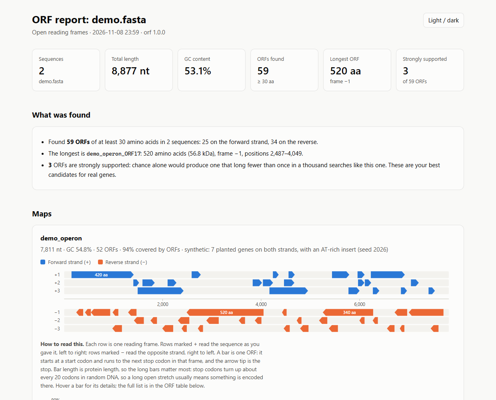
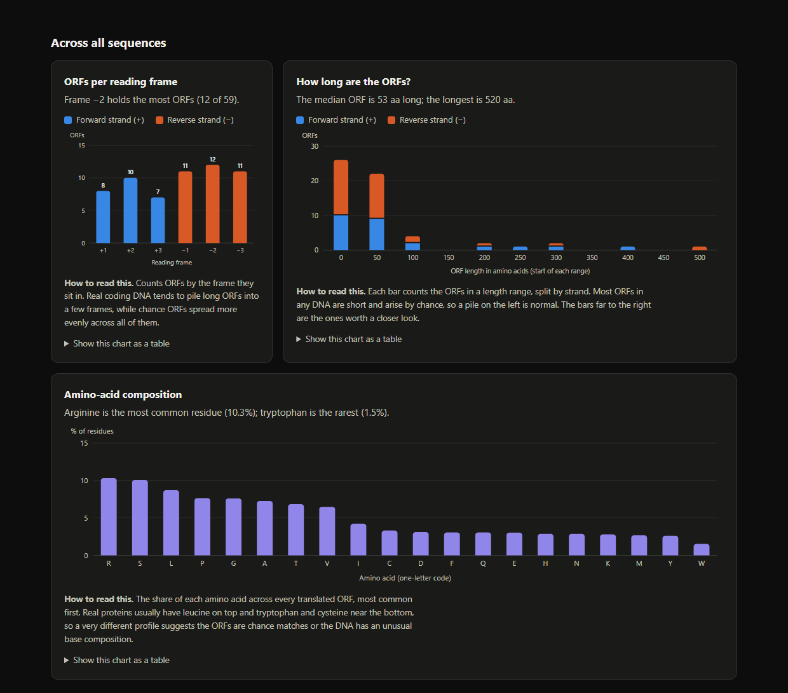

# Open Reading Frame

Find open reading frames (ORFs) in DNA, then actually see what you found.

`orf` scans a sequence on both strands and all six reading frames, translates what it finds,
scores how surprising each ORF is, and writes the results as tables, FASTA files and a single
HTML report with charts. It has no dependencies, just Python 3.9 or newer.



## Quick start

```bash
git clone https://github.com/prabirsh/Open-Reading-Frame.git
cd Open-Reading-Frame
python -m orf demo --open
```

That runs on a small example sequence that ships with the tool and opens the report in your
browser. No input file, no install.

For your own DNA:

```bash
python -m orf find my_sequence.fasta --open
```

Prefer a plain `orf` command? Install it once and use `orf` from anywhere:

```bash
pip install .
orf find my_sequence.fasta --open
```

## What you get

Everything goes into one folder (`orf_results/` unless you pick another with `-o`):

| File | What's in it |
|---|---|
| `report.html` | The report. One file, works offline, supports light and dark mode. **Open this first.** |
| `orfs.tsv` | One row per ORF: position, strand, frame, length, start and stop codon, GC, mass, support. Opens in Excel, R or pandas. |
| `proteins.faa` | The translated proteins, FASTA. |
| `orfs.fna` | The ORF nucleotide sequences, FASTA (reverse-strand ORFs are already reverse-complemented). |
| `summary.json` | Everything above in one JSON file. Only with `--json`. |

A short summary is also printed in the terminal, so you can see the shape of the result before
you open anything.

## Commands

### `orf find`

```text
orf find INPUT [options]
orf find --seq DNA [options]
```

`INPUT` can be a FASTA file, a plain text file with just the sequence, a `.gz` of either, or `-` to read from a pipe.
Lowercase, RNA (`U`) and IUPAC codes such as `N` are all fine. A FASTA file with many records is analysed record by record.

| Option | Meaning | Default |
|---|---|---|
| `-m`, `--min-length AA` | shortest ORF to keep, in amino acids | `30` |
| `-s`, `--strand` | `both`, `forward` or `reverse` | `both` |
| `-f`, `--frames LIST` | frames to scan, e.g. `1,2,3` or `2` | `1,2,3` |
| `-c`, `--code TABLE` | genetic code: `1` standard, `2` vertebrate mitochondrial, `11` bacterial/archaeal/plastid | `1` |
| `--starts LIST` | start codons, e.g. `ATG,GTG`; `table` allows every start the genetic code knows | `ATG` |
| `--nested` | report an ORF for every start codon, not just the outermost one before each stop | off |
| `--partial` | keep ORFs that run off the end of the sequence without a stop codon | off |
| `-o`, `--outdir DIR` | where to write the results | `orf_results` |
| `--top N` | ORFs listed in the report table | `50` |
| `--gc-window BP` | window size of the GC track | picked from the sequence length |
| `--title TEXT` | heading of the report | from the file name |
| `--no-report` | skip the HTML report | |
| `--json` | also write `summary.json` | |
| `--open` | open the report in your browser when done | |
| `-q`, `--quiet` | print nothing except errors | |
| `--no-color` | plain output (`NO_COLOR` also works) | |

Some examples:

```bash
orf find genome.fasta                           # everything, ORFs of 30 aa and up
orf find genome.fasta -m 100 --open             # long ORFs only, open the report
orf find reads.fa -s forward -f 1               # forward strand, frame 1 only
orf find plasmid.fa -c 11 --starts table        # bacterial code with its alternative starts
cat seq.txt | orf find - --partial              # from a pipe, keep ORFs cut off by the end
orf find --seq ATGAAATAG -m 1                   # a sequence typed right on the command line
```

### `orf translate`

Plain translation of whole frames, without looking for ORFs. FASTA goes to stdout, so it pipes nicely.

```bash
orf translate gene.fasta                        # all six frames
orf translate gene.fasta -f 2 -s forward        # just frame +2
orf translate gene.fasta --to-stop -o out.faa   # stop at the first stop codon, write a file
orf translate gene.fasta --rna                  # print the RNA instead
```

### `orf demo`

Runs `orf find` on the bundled example (`orf/data/demo.fasta`, synthetic sequences with genes planted on both
strands) and writes to `orf_demo/`. It is also a handy template for the input format.

Every command has `--help`, with examples at the bottom.

## Reading the report

The report is built so you can read it top to bottom, and each chart carries a short "How to read this" note.
The short version:

- **Summary tiles and "What was found"** answer the first question: how many ORFs, how long is the longest,
  and how many are statistically convincing. The text is generated from your data.
- **ORF map** (one per sequence). Each row is a reading frame. Rows marked `+` read your sequence left to
  right, rows marked `−` read the opposite strand. A bar is one ORF, an arrow tip marks its stop codon, and
  a paler flat-ended bar ran off the end of the sequence. Long bars are the interesting ones. Hover for details.
- **GC track**, lined up under the map. A dip or a plateau in GC content often marks DNA that came from
  somewhere else, or a gene boundary.
- **ORFs per reading frame.** Real genes tend to pile long ORFs into a few frames; chance ORFs spread out.
- **How long are the ORFs?** A histogram split by strand. A pile of short ORFs is normal (they happen by
  chance); the bars far to the right deserve a look.
- **Amino-acid composition** of everything that was translated.
- **ORF table.** Sort by any column, or filter by typing. Every chart also has a "show as a table" view.



### What "support" means

Stop codons turn up about every 20 codons in random DNA, so a long ORF is unlikely to be an accident.
For each ORF, `orf` works out how many ORFs that long chance alone would give you in a search of the same size,
using the base composition of your own sequence. That number is `E` in the table:

| Support | Meaning |
|---|---|
| strong | `E` < 0.001, chance would almost never produce one this long |
| moderate | `E` < 0.05 |
| weak | anything else, about as long as chance would give you |

This is a screening aid, not a gene predictor. A real short gene can look weak, and in unusual DNA a long
ORF can still be an accident. Treat "strong" as "worth following up", not as proof.

## How it works

- An **ORF** here is a start codon followed by codons with no in-frame stop, ending at the first stop codon.
  By default only the outermost start before each stop is reported; `--nested` reports every start.
- **Frames** `+1`, `+2`, `+3` start at base 1, 2 or 3 of the sequence you gave. Frames `−1` to `−3` do the same on its
  reverse complement.
- **Coordinates** are 1-based and inclusive, always counted along the sequence you gave, even for
  reverse-strand ORFs. So `start` is always smaller than `end`.
- The first amino acid of every ORF is shown as methionine, even when a different start codon was used (as in nature).
- **Ambiguous bases** (`N` and friends) are allowed. A codon containing one translates to `X` and can never start or end an ORF.
- **Mass** is the average mass of the translated protein, computed from the residues.
- Reading a 2 Mb sequence and writing all outputs takes a couple of seconds.

### Genetic codes

| Table | Name | Start codons used with `--starts table` |
|---|---|---|
| 1 | Standard | ATG, TTG, CTG |
| 2 | Vertebrate mitochondrial (AGA/AGG stop, TGA = W, ATA = M) | ATT, ATC, ATA, ATG, GTG |
| 11 | Bacterial, archaeal and plant plastid | TTG, CTG, ATT, ATC, ATA, ATG, GTG |

Another code is a single line in [`orf/codes.py`](orf/codes.py): the 64 amino acids in NCBI order plus its start codons.

## Troubleshooting

- **`orf` is not recognised.** You haven't installed it. Use `python -m orf ...` from the repository folder, or run `pip install .` first.
- **`unexpected character` error.** The file contains something that isn't DNA, such as digits or `*`. The message names the record and position.
- **No ORFs found.** Try a lower `--min-length`, add `--partial`, or `--starts table`. The terminal output suggests these when it finds nothing.
- **Odd symbols in the terminal.** Output falls back to plain ASCII on terminals that can't draw box characters. Use `--no-color` to turn off colour.

## Development

```bash
python -m unittest discover -s tests -t . -v    # the test suite, standard library only
python tools/make_demo.py                       # regenerate the demo sequences
```

The tests include a brute-force reference implementation that the ORF finder is compared against on random
sequences, and a check that the "support" statistics hold up on random DNA.

```text
orf/
  cli.py         command line: argument parsing, help text, terminal summary
  seqio.py       reading FASTA, plain text, gzip and stdin
  finder.py      the ORF scan
  codes.py       genetic code tables
  stats.py       GC, protein mass, histogram bins, chance expectation
  analysis.py    runs the finder and gathers everything the outputs need
  exporters.py   TSV, FASTA and JSON writers
  charts.py      inline SVG charts
  report.py      the HTML report
  term.py        colour, tables and bars for the terminal
  data/          the bundled demo sequences
tests/           unit tests
tools/           scripts for maintainers
docs/            screenshots used in this README
```

## License

[MIT](LICENSE)
